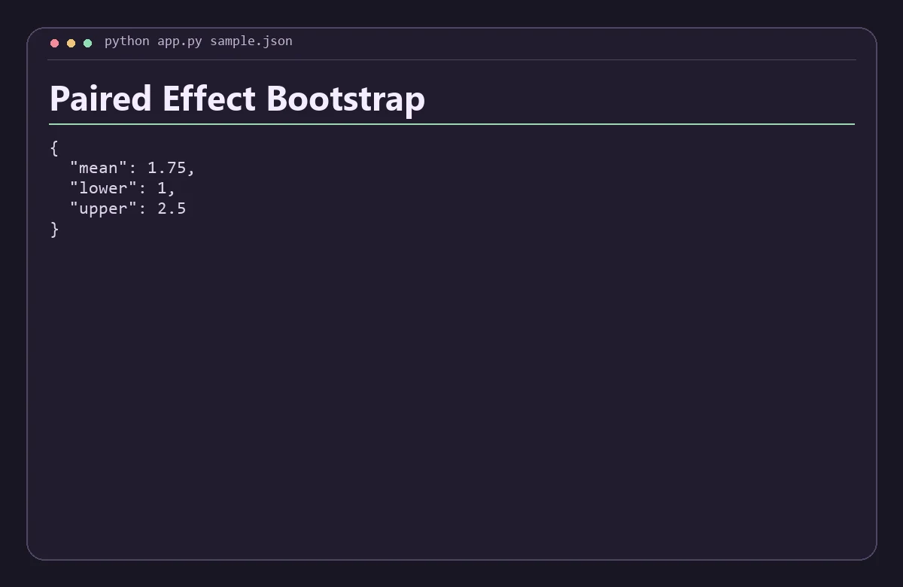

# Paired Effect Bootstrap

Estimate a percentile interval for the mean of paired differences using seeded resampling.



## Run

Install Python 3.11 or newer. Run these commands from the repository root.

```sh
python app.py sample.json
```

Replace `sample.json` with a JSON file following the same structure. The app prints a JSON report to standard output.

Pair samples by index and tune the draw count and seed. The output reports the mean and the 2.5th and 97.5th percentile approximations. This is an educational percentile interval.

## Verify

Run `python check.py` with Python 3.11 or newer after the build step when applicable. The check verifies the bundled scenario and confirms that an invalid input returns an error.
